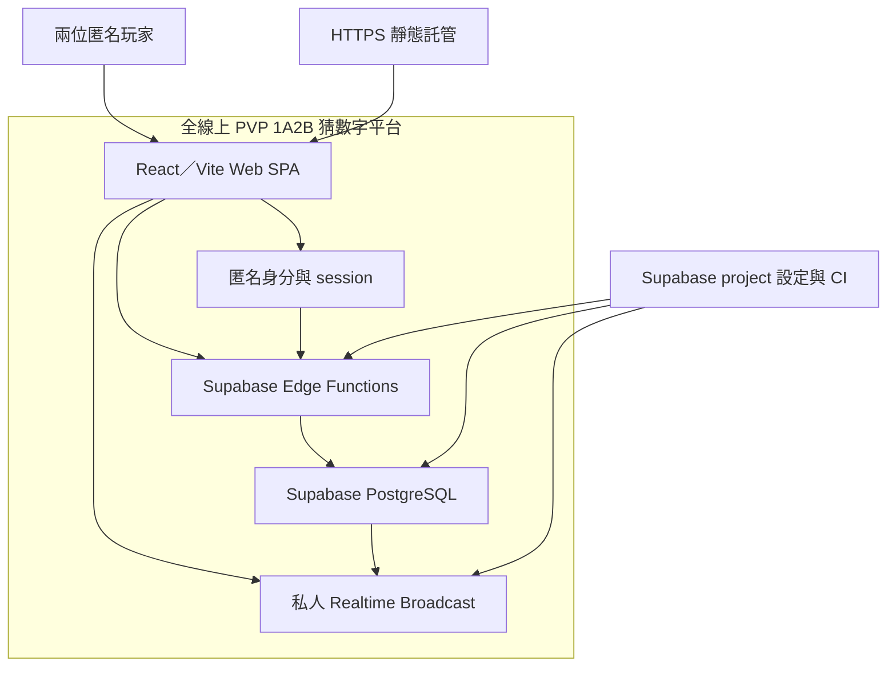
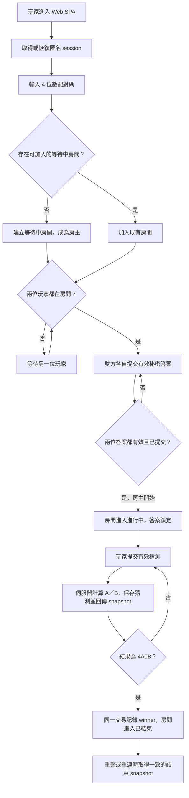

# 系統規劃與界面分析追蹤：全線上 PVP 1A2B 猜數字平台

依 `specs/online-pvp-1a2b/spec.md`、`specs/online-pvp-1a2b/research.md` 與 `specs/online-pvp-1a2b/techstack.md`，確立匿名雙人對戰平台的系統邊界、模組分工、核心流程、粗略交付順序及界面分析波段。此範例展示規劃完成、尚未委派分析的狀態；資料欄位、完整 API 契約、詳細 UI、交易與部署設計由各 Planner 分別交付。

## 系統邊界與外部依賴



| 邊界或依賴 | 分工與資料責任 |
| --- | --- |
| 玩家與 Web SPA | 玩家輸入配對碼、答案及猜測，查看自己的狀態、猜測結果與對戰結果；瀏覽器只持有匿名 session、publishable 設定及伺服器投影的 snapshot。 |
| Web SPA 與 Edge Functions | 所有會改變共享狀態的命令經 JWT 保護的 Edge Function 傳送；Edge Function 從驗證後 JWT 取得 caller UID，不接受 client supplied actor ID。 |
| Edge Functions 與 PostgreSQL | Edge Function 呼叫單一資料庫 RPC，在短交易內驗證成員與房間狀態、寫入資料並回傳遮蔽 snapshot；資料庫是房間、答案、猜測及勝負的權威來源。 |
| Web SPA 與 Realtime | 私人 Broadcast 只傳送 room、state version、事件種類等失效通知；瀏覽器收到通知後重新取得 snapshot，不把 Broadcast 當成遊戲真相。 |
| Anonymous Auth | 以匿名 authenticated user UID 識別玩家及其房間成員資格；清除瀏覽器資料或登出後無法承諾跨裝置找回匿名帳號。 |
| Supabase project 與靜態託管 | 提供 PostgreSQL、Auth、Edge Functions 與 Realtime；Web build 需由 HTTPS host 提供，正式網域、CORS、CAPTCHA、region、方案與 secrets 尚待設定。 |

房間、成員、秘密答案、猜測及命令回覆均保存於伺服器端。`secret_answers` 不提供給瀏覽器角色直接讀取；任何對手答案的揭露只在遊戲結束且符合產品允許的結果投影時發生。檔案儲存、聊天、排行榜、觀戰、積分及多房間邀請不在本版本邊界。

## 主要模組責任與依賴

| 模組 | 核心責任與產出 | 主要依賴 |
| --- | --- | --- |
| 匿名身分與 session | 建立或恢復匿名玩家 session，提供 caller UID 與重新整理後的身份承接 | Supabase Anonymous Auth、瀏覽器 session |
| 房間與成員狀態 | 依 4 位數配對碼建立或加入等待中房間，限制兩位成員，維護房主與 waiting／playing／ended 狀態 | Edge Functions、PostgreSQL unique constraint／row lock、匿名 UID |
| 答案準備與開始 | 驗證雙方秘密答案，回報準備狀態，僅允許房主在兩位玩家皆準備後開始，開始後鎖定答案 | 房間與成員狀態、答案隱私投影 |
| 1A2B 判定與對戰結果 | 驗證猜測、計算 A／B、保存猜測紀錄，於 4A0B 時在同一交易設定 winner 並結束房間 | PostgreSQL RPC、房間 row lock、既定答案規則 |
| Snapshot 與即時同步 | 依 caller UID 產生遮蔽 room snapshot，處理重整、重連及 state version，透過私人 Broadcast 通知另一位玩家 | PostgreSQL、RLS、Realtime private channel |
| 授權與資料保護 | 維護 RLS、grants、RPC execute 邊界與 service key 使用界線，避免對手取得秘密答案 | Supabase Auth JWT、PostgreSQL RLS、Edge Function secrets |
| 驗證與交付 | 以 migrations、pgTAP、Vitest、Playwright 及 CI gates 驗證狀態轉移、併發、隱私、重連與完整 PVP 流程 | Supabase CLI／local stack、Node 24、瀏覽器測試環境 |

共享狀態的唯一 owner 是伺服器 snapshot；前端 component state 只保存輸入與顯示暫態。命令重試以 `(actor_id, request_id)` receipt 保持冪等；同一猜測若使用不同 request ID，依規格仍可被分別記錄。

## 核心業務流程



配對碼、答案與猜測均由伺服器驗證；格式錯誤、房間已滿、狀態不符或房主尚未滿足開始條件時，命令不得留下部分資料。兩位玩家可在進行中各自提交猜測；同時猜中時，以先完成伺服器序列化判定者為 winner，後到命令讀到已結束狀態而被拒絕。房主在等待中離開時，本版本不自動轉移房主資格；進行中斷線則保留伺服器狀態，實際重連期限與逾時行為列為未決事項。

## 後續分析的共同約束

以下承接 `spec.md` 的需求及 `research.md` 的既定技術方向，作為各界面分析的共同輸入；技術版本沿用 `techstack.md`，尚未確認的產品與部署設定見「未決事項與規劃影響」。

| 共同約束 | 對後續分析的影響 | 依據 |
| --- | --- | --- |
| 共享遊戲狀態由伺服器判定與保存 | 操作、服務與資料界面須維持一致的房間狀態、操作權限及勝負結果；前端依伺服器 snapshot 呈現。 | FR-012、NFR-005；R02 |
| 並行操作與請求重試須維持一致性 | 建房、加入、開始及猜中結束時，須維持同配對碼唯一有效房間、兩人上限及唯一勝者；失敗或重送請求不得留下部分資料或重複生效。 | FR-003、FR-007、FR-010、NFR-001、NFR-005；R02 |
| 秘密答案的可見範圍由伺服器控制 | 操作顯示、服務回覆、資料存取及同步通知須共同遵守答案隱私；結束後是否揭露答案仍依產品決策。 | FR-006、NFR-002；R03 |
| 即時通知與權威狀態讀取分工明確 | Realtime 僅通知狀態變更；通知抵達、重新整理或重連時，均透過 snapshot 恢復一致狀態，並限制頻道的成員存取。 | NFR-004；R04 |
| 玩家身分採匿名 session | 房間成員與權限以匿名 UID 辨識；操作及恢復流程須處理 session 失效，跨裝置帳號復原不在本期範圍。 | 規格假設；R03 |
| 驗證須涵蓋跨玩家與授權邊界 | 各界面分析須交代正常、拒絕、並行及恢復情境，供後續資料庫與多玩家整合測試承接。 | SC-001～SC-003、NFR-001～NFR-005；R05 |

## 目標專案結構

```text
web/
├── src/                    # React SPA、操作流程與 snapshot 顯示
└── tests/                  # 前端純規則與 mapper 單元測試
supabase/
├── migrations/             # schema、constraints、RLS、RPC 與 Realtime policy
├── functions/              # JWT 保護的命令與 snapshot Edge Functions
└── tests/                  # pgTAP 資料庫、狀態機與授權測試
tests/
└── e2e/                    # Playwright 的 A／B／C 多 BrowserContext 流程
docs/                       # 架構脈絡、操作與部署說明
.github/workflows/          # build、typecheck、Vitest、資料庫與 E2E gates
```

前端只負責輸入、顯示與同步觸發；狀態規則、秘密答案存取及跨玩家一致性留在 Edge Functions／PostgreSQL。具體檔名、共用 DTO 及 migration 拆分由後續詳細設計與開發任務展開。

## MVP 範圍與交付順序

MVP 覆蓋三個 P0 使用者故事：以匿名玩家建立／加入兩人房間、雙方準備答案並由房主開始，以及雙方提交猜測直到 4A0B 結束。MVP 同時包含刷新／重連後的 server snapshot、一致的錯誤拒絕、答案隱私與並行安全驗證。登入註冊、好友、聊天、排行榜、觀戰、積分、限時回合、斷線淘汰及多房間邀請延後。

以下為粗略交付依賴，需求優先級與驗收條件以 `specs/online-pvp-1a2b/spec.md` 為準。

| 里程碑 | 前置依賴與需求範圍 | 可交付成果 |
| --- | --- | --- |
| M0：本機基線與狀態邊界 | spec、research、techstack；完成 Node／Supabase CLI／local stack 的固定與可重現入口 | 可啟動的 Web／Supabase 專案骨架、版本鎖定與基本 CI 入口 |
| M1：匿名房間基礎 | M0；US-001、FR-001～FR-004、NFR-001 | 匿名 session、join-or-create、兩人上限、active code 競態保護與房間 snapshot |
| M2：答案準備與開始 | M1；US-002、FR-005～FR-007、NFR-002 | 私密答案提交、準備狀態、房主開始條件、答案鎖定與授權測試 |
| M3：對戰判定與同步 | M2；US-003、FR-008～FR-012、NFR-003～NFR-005 | 1A2B 判定、猜測紀錄、4A0B 結束、winner 序列化、private Broadcast、刷新／重連一致性 |
| M4：完整驗證與公開配置 | M3；SC-001～SC-003、R05 待驗證項 | 多玩家 Playwright、pgTAP／RLS、build／typecheck／Vitest、雲端 smoke test 與正式部署設定 |

M1～M3 可在本機 stack 逐步驗證；M4 才判定 hosted project 的 region、host、CORS、CAPTCHA、配額與網路行為。日期、人力與預算尚未由來源確認，排程須待詳細分析與公開配置決策後估算。

## 未決事項與規劃影響

以下保留會影響後續分析、測試或公開啟用的缺口；不阻擋目前已可形成的系統邊界與分析安排。

| 編號與狀態 | 未決事項與影響 | 待取得的結論或結果 | 負責角色與處理時點 |
| --- | --- | --- | --- |
| U1：待修正 | `spec.md` 的 US-003 驗收案例以答案 `5678`、猜測 `1679` 寫成 `1A1B`；依既定 1A2B 規則應為 `2A0B`。若不修正，領域測試與驗收會互相矛盾。 | 確認並修正驗收案例的預期結果，再供 1A2B 與 E2E 測試承接。 | 需求維護者；進入對戰詳細設計前 |
| U2：待產品決策 | 匿名玩家的允許重連期間、逾時後房間行為、已結束資料保存期及 anonymous user cleanup 未定，影響 retention、排程與客服文案。 | 確認重連期限、房間逾時／保留規則及匿名帳號清理政策。 | 產品／營運；公開發佈前 |
| U3：待公開配置 | Supabase project region、PostgreSQL major、正式方案／配額、靜態 host／網域、CORS allowlist、CAPTCHA provider、rate limit 與 observability 未定，影響公開 smoke test 與營運邊界。 | 完成 hosted project 與正式網域配置，並通過真實環境授權、Realtime、網路與限額驗證。 | 維護者／營運；M4 公開啟用前 |
| U4：待驗證 | Supabase CLI、Docker／Podman 與套件精確版本須在 bootstrap 重新查核並鎖定；研究中的版本基線尚不代表已安裝或建置成功。 | 產生 lockfile、固定 local／CI 工具版本，通過 build、typecheck、Vitest、pgTAP 與 Playwright。 | 維護者；M0～M4 |

## 分析流程規劃

本節規劃分析對象、順序與平行分工；各項工作尚待委派，主責、預定產物及實際狀態見「工作執行與產物紀錄」。預期分析結果不視為已完成結論。

### 端點分類與待分析界面

以下依本案角色分類分析端點；責任與跨端互動承接前述「系統邊界與外部依賴」。

| 分類 | 端點 | 待獨立分析的界面 |
| --- | --- | --- |
| 應用端 | React／Vite Web SPA | 玩家操作界面<br>snapshot 顯示與重連界面 |
| 服務端 | Supabase Edge Functions | 房間與對戰命令界面<br>房間 snapshot 讀取界面 |
| 資料端 | Supabase PostgreSQL | 狀態資料與 RPC 存取界面 |
| 支援服務 | Supabase Anonymous Auth | 匿名 session 與 caller 身分界面 |
| 支援服務 | Supabase Realtime | private Broadcast 通知與頻道授權界面 |
| 執行與交付環境 | Supabase project／HTTPS 靜態託管／CI | Web 託管與 CORS／secrets 界面<br>驗證、部署與維運管理界面 |

每個界面各自對應一項分析工作，名稱為「界面名稱＋分析」；手機使用納入同一 Web SPA，不另列原生 Mobile 端點。Realtime 的通知界面與 snapshot 讀取界面分開保留，因前者只負責失效通知，後者才提供可恢復的權威資料。

### 分波段平行分析計畫

波段依表格由上至下推進，相同波段內的各項分析工作可平行執行；每項工作先取得表列的必要輸入。

| 波段 | 獨立分析工作（同波段可平行） | 必要前置輸入 |
| --- | --- | --- |
| 玩家與身份邊界 | 玩家操作界面分析<br>匿名 session 與 caller 身分界面分析 | `spec.md` 的 US-001～US-003、角色權限與匿名識別假設；兩項工作沒有彼此必須等待的產物 |
| 狀態資料邊界 | 狀態資料與 RPC 存取界面分析 | 前波的操作需求與匿名 UID 邊界，加上 R02～R03 的資料權威、row lock、RLS 與命令 receipt 方向；此工作先釐清房間、成員、答案、猜測及狀態轉移的資料責任 |
| 服務命令與同步契約 | 房間與對戰命令界面分析<br>房間 snapshot 讀取界面分析<br>private Broadcast 通知與頻道授權界面分析 | 狀態資料與 RPC 存取界面分析的交易／狀態結果、匿名 session 與 caller 身分界面分析的 caller 邊界、玩家操作界面分析的命令與可見性需求；三項工作可平行，分別釐清命令、權威讀取與以 membership 保護的通知界面 |
| 客戶端同步與交付配置 | snapshot 顯示與重連界面分析<br>Web 託管與 CORS／secrets 界面分析<br>驗證、部署與維運管理界面分析 | snapshot 顯示與重連界面分析承接房間 snapshot 讀取界面分析及 private Broadcast 通知與頻道授權界面分析；託管與維運兩項工作承接 Web／服務的 build、執行入口及 Auth／Realtime／PostgreSQL 整合邊界。U2～U4 中尚未取得的產品決策、正式配置與版本驗證結果另列為待取得輸入；分析可先規劃其設定邊界與驗證方式，實際配置與驗證交後續實作 |

規劃及各波段回收時逐項核對端點分類表，確認每個界面均有一項同名分析工作；任何新的必要依賴先調整波段，再啟動受影響分析。開發交付依 M0～M4 追蹤，與本表的分析順序分開管理。

### 工作執行與產物紀錄

下列皆為範例中的待執行工作，路徑是預定輸出，尚無已完成產物。所有名稱與前述界面及波段一致；同一 Planner 的多個工作仍分別委派及驗收。

| 獨立分析工作 | 主責 Planner 與理由 | 產物路徑 | 狀態 | 未決事項與影響 |
| --- | --- | --- | --- | --- |
| 玩家操作界面分析 | `ui-ux-plan`：玩家輸入、操作條件與畫面狀態 | `analysis/玩家操作界面.md` | 待執行 | 依需求先交付操作與可見性需求，不等待完整 API 或視覺設計。 |
| 匿名 session 與 caller 身分界面分析 | `api-plan`：session 與 caller 信任邊界 | `analysis/匿名 session 與 caller 身分界面.yaml` | 待執行 | 先分析既有身分服務邊界；若需交付實際 HTTP 操作，採 OpenAPI 並同步更新路徑。U2 必要決策明列，匿名 UID 已知部分可先分析。 |
| 狀態資料與 RPC 存取界面分析 | `data-plan`：資料責任、狀態與交易一致性 | `analysis/狀態資料與 RPC 存取界面.dbml` | 待執行 | DBML 定義模型，Notes 補充交易、權限與交接；U1 的驗收案例矛盾交回需求來源，U2 保存期未決不以猜測補齊。 |
| 房間與對戰命令界面分析 | `api-plan`：命令、權限與拒絕契約 | `analysis/房間與對戰命令界面.openapi.yaml` | 待執行 | HTTP 契約以 OpenAPI 為來源，x-analysis 保留來源及交接；必要狀態／交易結果未取得前不啟動。 |
| 房間 snapshot 讀取界面分析 | `api-plan`：權威狀態讀取與資料投影契約 | `analysis/房間 snapshot 讀取界面.openapi.yaml` | 待執行 | HTTP 讀取契約與 x-analysis 同檔交付；承接 caller 及資料可見性結果，不與通知契約合併。 |
| private Broadcast 通知與頻道授權界面分析 | `api-plan`：通知與成員頻道存取契約 | `analysis/private Broadcast 通知與頻道授權界面.yaml` | 待執行 | 非 HTTP 分析 YAML 保存通知、授權與交接，失效通知與權威讀取分工遵守共同約束。 |
| snapshot 顯示與重連界面分析 | `ui-ux-plan`：客戶端狀態恢復與顯示 | `analysis/snapshot 顯示與重連界面.md` | 待執行 | 等待 snapshot 讀取及 Broadcast 通知的必要契約；U2 未定部分另列。 |
| Web 託管與 CORS／secrets 界面分析 | `api-plan`：執行入口、設定與信任邊界 | `analysis/Web 託管與 CORS、secrets 界面.yaml` | 待執行 | 結構化 YAML 記錄設定責任及檢查要求；路徑將分隔字元改為頓號，U3 正式設定仍待取得。 |
| 驗證、部署與維運管理界面分析 | `api-plan`：交付控制、CI gates 與維運責任 | `analysis/驗證、部署與維運管理界面.yaml` | 待執行 | 結構化 YAML 記錄維運契約；U2～U4 的決策及驗證仍待取得，不宣告 hosted smoke test 已通過。 |

### 整體分析狀態與接續

整體分析狀態：待執行。目前僅完成系統輪廓與分析安排，尚無 Planner 分析產物，不能宣告整體分析完成。

接續由主流程啟動「玩家與身份邊界」兩項工作，回收並驗收後供後續承接；其餘依必要輸入推進。U1～U4 保留原有影響與處理時點，只有真正缺少必要結果的工作維持待補輸入；範例本身不代表 PVP 專案已實際執行。
