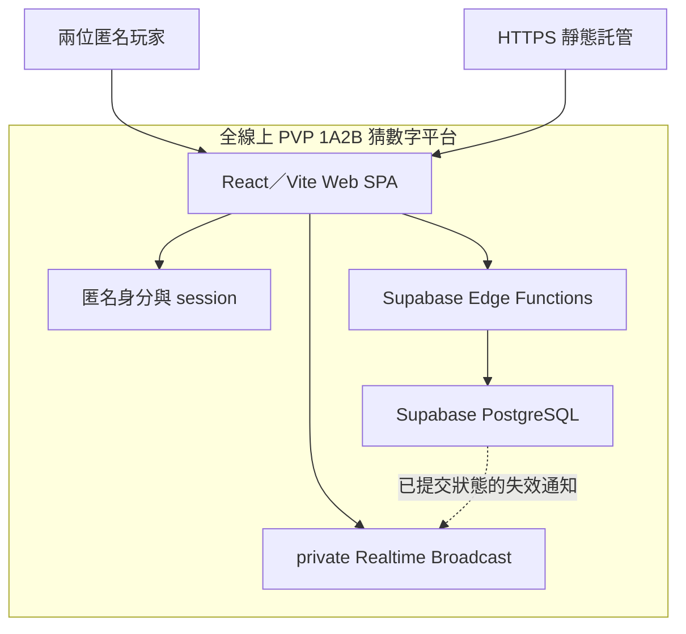

# 系統規劃：全線上 PVP 1A2B 猜數字平台

依 [spec.md](../../../../specs/online-pvp-1a2b/spec.md)、[research.md](../../../../specs/online-pvp-1a2b/research.md) 與 [techstack.md](../../../../specs/online-pvp-1a2b/techstack.md)，整理核心對戰的系統邊界、共同約束與分析分工。詳細行為由需求與各領域產物維護；本文件提供實作交接所需的共同輪廓與產物入口。

## 系統範圍與邊界

MVP 涵蓋 US-001～US-003：匿名玩家以四位配對碼建立／加入兩人房間、提交秘密答案、由房主開始、各自猜測直到 4A0B 結束，並在刷新／重連後恢復權威狀態。帳號註冊、跨裝置復原、聊天、排行榜、觀戰、積分、限時回合及重新開局不在本輪範圍。



| 端點 | 核心責任與邊界 |
| --- | --- |
| Web SPA | 玩家輸入、畫面狀態與同步恢復；只維護本地暫態及伺服器允許顯示的資料。 |
| Anonymous Auth | 建立／恢復同一瀏覽器的匿名 session，提供可驗證的 caller UID。 |
| Edge Functions | 驗證 JWT，將可信 caller 交給受控 RPC，提供命令與遮蔽 snapshot；服務密鑰只留在伺服器。 |
| PostgreSQL | 持有房間、成員、答案、猜測、勝負與命令結果，負責狀態轉移及交易一致性。 |
| Realtime | 向獲授權房間成員傳送失效通知；發布路徑於實作時確認，僅能使用已提交的狀態版本。 |

## 核心流程

取得匿名 session → 輸入配對碼建立／加入房間 → 雙方提交答案 → 房主開始 → 雙方各自提交猜測 → 4A0B 結束。詳細輸入、權限及拒絕條件以 `spec.md` 為準。

同時猜中時，由先完成伺服器序列化判定者勝出；等待中房主離開不自動轉移資格。暫時斷線保留伺服器狀態，重連期限與逾時後行為見 U2。

## 共同約束

| 共同約束 | 各領域須維持的結果 | 依據 |
| --- | --- | --- |
| 伺服器權威與可信身分 | 操作以驗證後 JWT UID 為 caller，逐次檢查 member／host 與狀態；前端不得指定 actor 或裁決勝負，service role 不能省略授權。 | FR-007、FR-012、NFR-005；R02、R03 |
| 並行與重試一致性 | 同配對碼僅一個有效房間、每房最多兩人、唯一勝者；寫入原子提交，同命令重送不重複生效，不同命令仍可記錄相同猜測。 | FR-003、FR-004、FR-009、FR-010、NFR-001、NFR-005；R02 |
| 資訊可見性 | 由服務／資料層控制答案與猜測投影；U5、U6 未定前沿用既有保守設計：不回傳原始答案，只提供 caller 自己的猜測紀錄。 | FR-006、NFR-002；R03；既有資料／API 分析 |
| 通知與權威讀取分工 | Broadcast 只通知狀態可能失效；初次訂閱、通知、刷新及重連後以 snapshot 同步，同房版本不得倒退，未授權者不得取得私有通知。 | NFR-004；R04；既有同步分析 |

既定定位方式（P-API-01）：以服務發出的 `roomId` 讀取特定房間，它只負責定位，存取仍需授權；不由此推導一個 UID 只能有一個有效房間。`stateVersion` 的精確字串格式由 API 與 Realtime 契約共同維護。

最低執行前提：前端只使用公開 project URL／publishable key；JWT 於執行期取得，service-role／receipt fingerprint 密鑰留在伺服器。開發環境須能使用匿名登入、受保護 Functions／RPC 與 private channel；HTTP 跨來源呼叫需配置相應來源、方法及標頭。實際設定與環境尚待 U3／U4 完成。

## 目標專案結構

```text
web/                       # React SPA、輸入、顯示及同步
supabase/
├── migrations/            # 資料結構、RLS、RPC 與頻道 policy
├── functions/             # 命令與 snapshot Edge Functions
└── tests/                 # 資料規則及授權驗證
tests/e2e/                 # 多玩家完整流程驗證
docs/                      # 必要的操作與交付說明
```

此為目標結構，尚未建置。核心實作依「房間配對 → 答案準備與開始 → 猜測、結束與同步恢復」推進；環境建置、測試案例、具體開發任務及 CI 配置由後續工作展開，版本與工具沿用 `techstack.md`。

## 分析分工與產物索引

本輪交付僅五份：本計畫、OpenAPI YAML、DBML、HTML prototype 與 UI／UX Markdown；共用規則只在其負責產物維護。

| 分析工作 | 主責與分析重點 | 現行交付 |
| --- | --- | --- |
| 玩家操作與同步體驗 | `ui-ux-plan`：以畫面評審操作、狀態與恢復；文件只記錄意圖、限制及契約入口。 | [HTML prototype](../../ui-ux-plan/templates/prototype.example.html)、[簡短 UI 紀錄](../../ui-ux-plan/templates/ui-ux-plan.example.md) |
| HTTP 服務與身分約定 | `api-plan`：四項命令及 snapshot GET、共用 DTO、授權、拒絕與同命令恢復；匿名登入沿用 SDK，不新增路由。 | [OpenAPI](../../api-plan/templates/openapi.example.yaml) |
| 狀態失效通知 | `api-plan`：private topic、三欄 payload、commit 後發布、收送權限、遺失／亂序／重連；以 OpenAPI 擴充區保留非 HTTP 語意，不虛構 HTTP 路由。 | [OpenAPI 的 x-realtime](../../api-plan/templates/openapi.example.yaml) |
| 資料模型與存取 | `data-plan`：結構、交易、不變條件、receipt、RLS／grants 與 caller 投影直接保留於 DBML Notes。 | [DBML](../../data-plan/templates/schema.example.dbml) |

分析依賴：操作／身分 → Data → HTTP／Realtime → UI 回查；無依賴部分可平行分析。此為資訊順序，不要求先完成所有畫面。

命令與 GET 已統一使用 `RoomSnapshot`、`Readiness`、`CallerGuess`、`StateVersion`；欄位為 `isCallerHost`、`callerResult`、`callerGuesses` 與 `readiness.callerReady/opponentReady`。`requestId` 統一作 HTTP 診斷碼，`commandId` 作同一命令的重送識別。舊核心檔案已由上述產物取代，不保留兩套契約。

HTML 是 UI 的主要交付：單檔、假資料、可直接開啟，提供自由操作及主要流程／拒絕／恢復導覽。Pencil 視評審需要再使用，不固定雙份維護；prototype 不等同正式前端或真實多人／session 恢復驗證。

公開交付的設定、備份／恢復、輪替、監測及發布程序於公開交付前展開；本輪只保存影響實作的最低前提與下表未決事項，不另交維運文件。詳細設定未完成前不能視為可公開啟用。

## 未決事項與下一步

| 事項 | 影響與目前處理方式 | 接手與處理時點 |
| --- | --- | --- |
| U1：規格算例矛盾 | 答案 `5678`、猜測 `1679` 應為 `2A0B`，`spec.md` 仍寫 `1A1B`。阻塞該驗收預期定稿，修正前不能採用原算例作為測試依據。 | 需求維護者；展開該案例測試前修正來源。 |
| U2：生命週期 | 重連期限、房主離開／逾時後行為、資料與 receipt 保留、匿名帳號清理未定。沿用現有保守設計，不新增 TTL 或自動清理規則。 | 產品／資料；涉及生命週期的功能實作及公開啟用前定稿。 |
| U3／P-OPS-01：公開配置與維運 | 正式 project／host、網域、CORS、CAPTCHA、限額、觀測、備份／恢復及秘密輪替待確認；不得因延後展開而視為可公開啟用。receipt fingerprint 輪替仍須維持既有重送保證。 | 維護者／營運；公開交付及輪替前補設計與驗證。 |
| U4：環境基線 | 工具與套件須重新查核並固定版本，建立 lockfile；研究版本表不代表已建置成功。 | 實作者；環境建置時完成。 |
| U5／U6：結果資訊可見性 | 結束後答案揭露與對手猜測公開規則未定；目前只顯示 caller 的結果與猜測，不新增答案／對手活動區。 | 產品；相關投影定稿前確認，變更時同步 API、Data、UI。 |
| 整併驗證 | 主產物已建立；本次文件解析、範例與原型流程的檢查結果見 UI 紀錄。關鍵服務驗證期待仍保留在 API／Data／Realtime。 | 測試規劃與實作者；展開正式測試及實作。 |

目前狀態：核心分析與互動 prototype 已整併，可供評審與後續測試規劃。U1 衝突算例仍待來源修正；正式程式、SQL／授權、多人併發與部署均未完成。公開交付仍須取得 U2～U6 的相關決策及實際驗證結果。
