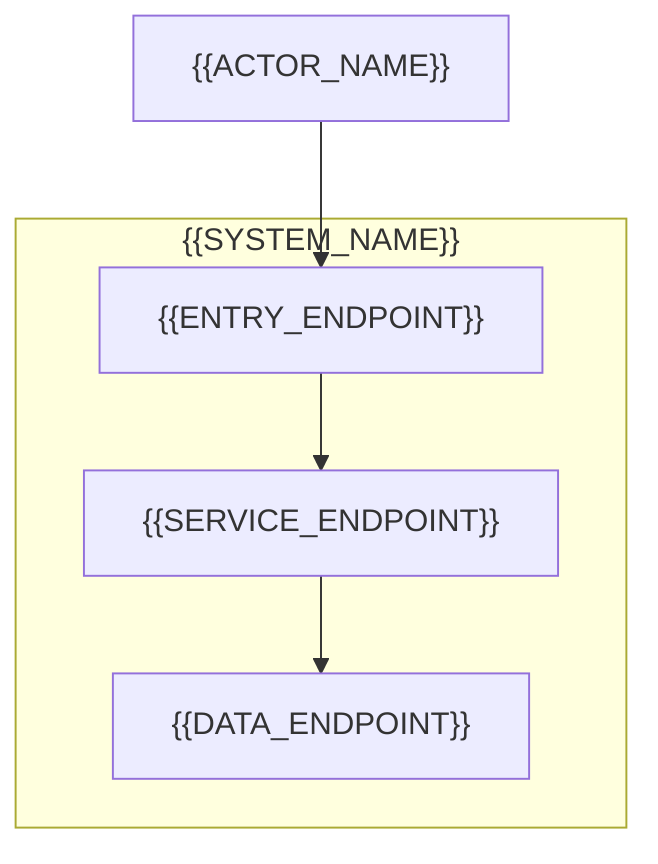

# 系統規劃：{{SYSTEM_NAME}}

{{ACTUAL_INPUT_SOURCES_AND_PLAN_PURPOSE}}

## 系統範圍與邊界

{{CURRENT_DELIVERY_SCOPE_AND_DEFERRED_CAPABILITIES}}

<!-- 按實際端點增刪節點與連線；圖與下表共同表達邊界，沒有新的來源就不新增應用或服務。 -->


| 端點 | 核心責任與邊界 |
| --- | --- |
| {{ENDPOINT_NAME}} | {{RESPONSIBILITY_AND_TRUST_BOUNDARY}} |

## 核心流程

{{MAIN_BUSINESS_FLOW}}

{{MATERIAL_ROLE_STATE_AND_FAILURE_EXCEPTIONS}}

## 共同約束

| 共同約束 | 各領域須維持的結果 | 依據 |
| --- | --- | --- |
| {{CROSS_ARTIFACT_CONSTRAINT}} | {{REQUIRED_SHARED_BEHAVIOR}} | {{ACTUAL_SOURCE_REFERENCE}} |

{{MINIMUM_RUNTIME_PREREQUISITES_AND_UNVERIFIED_BOUNDARIES}}

## 目標專案結構

<!-- 依已確認邊界增刪目錄，只展示目前需要理解的責任，不列尚未決定的檔案或空層級。 -->
```text
{{APPLICATION_DIRECTORY}}/     # {{APPLICATION_RESPONSIBILITY}}
{{SERVICE_DIRECTORY}}/         # {{SERVICE_RESPONSIBILITY}}
{{DATA_DIRECTORY}}/            # {{DATA_RESPONSIBILITY}}
```

{{IMPLEMENTATION_ORDER_AND_STRUCTURE_READINESS}}

## 分析分工與產物索引

<!-- 依適用性保留列；同責任的界面整合交付。事件／session 放進 OpenAPI 擴充區，無 HTTP 操作時保留 paths: {}。 -->
| 分析工作 | 主責與分析重點 | 現行交付 |
| --- | --- | --- |
| {{UI_ANALYSIS_SCOPE}} | ui-ux-plan：{{UI_DELIVERY_FOCUS}} | [HTML prototype]({{HTML_PROTOTYPE_PATH}})、[UI／UX 紀錄]({{UI_UX_MARKDOWN_PATH}}) |
| {{SERVICE_ANALYSIS_SCOPE}} | api-plan：{{HTTP_AND_NON_HTTP_CONTRACT_FOCUS}} | [OpenAPI]({{OPENAPI_PATH}}) |
| {{DATA_ANALYSIS_SCOPE}} | data-plan：{{DATA_DESIGN_FOCUS}} | [DBML]({{DBML_PATH}}) |

{{NECESSARY_ANALYSIS_DEPENDENCIES_AND_USABLE_PARTIAL_RESULTS}}

{{CROSS_ARTIFACT_DECISIONS_AND_DEFERRED_OPERATIONAL_DEPTH}}

## 未決事項與下一步

| 事項 | 影響與目前處理方式 | 接手與處理時點 |
| --- | --- | --- |
| {{OPEN_ISSUE_OR_NO_OPEN_ISSUES}} | {{LOCAL_IMPACT_AND_CURRENT_BOUNDARY}} | {{OWNER_AND_RESOLUTION_TIMING}} |

{{ACTUAL_ANALYSIS_AND_VALIDATION_STATUS_AND_NEXT_ACTION}}
