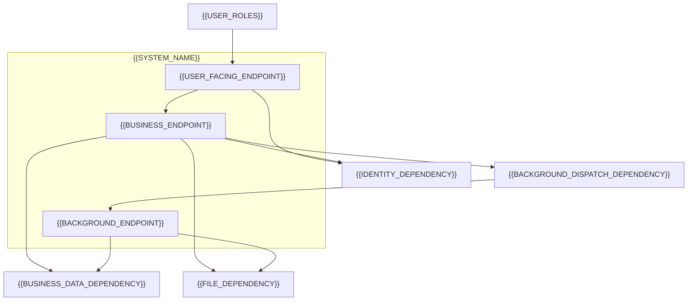
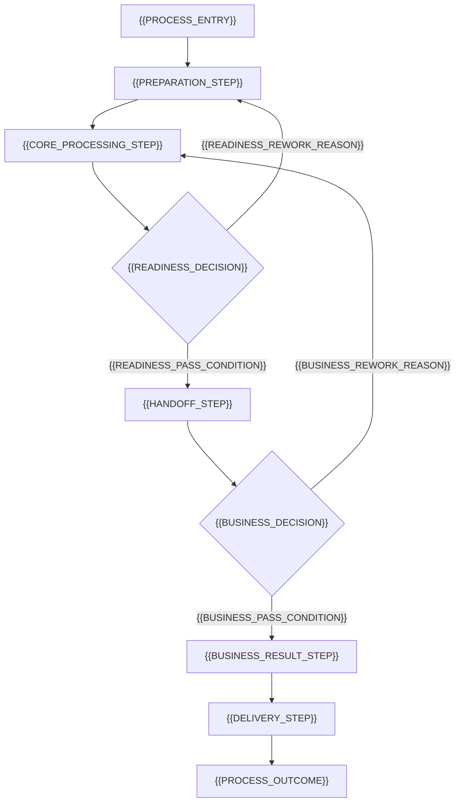

# 系統規劃與界面分析追蹤：{{SYSTEM_NAME}}

依 `{{SPEC_FILE}}`、`{{RESEARCH_FILE}}` 與 `{{TECHSTACK_FILE}}`，確立系統邊界、模組分工、核心流程及交付順序，再依分析波段委派 Planner。詳細結論保存在各界面產物，本文件追蹤規劃、依賴與執行狀態。

<!-- 填寫提示：依已確認需求與實際取得的輸入填入內容。若未提供規格、研究或技術棧文件，改寫開頭、「後續分析的共同約束」前言及 MVP 段的來源引用句，只列實際輸入；將會影響規劃的缺口列為未決事項。圖中節點、連線、表格列、目錄及波段皆依本案調整，範例數量與先後順序不是固定要求，單端點需求亦可產出。完成產物時移除所有填寫提示及未替換槽位。 -->

## 系統邊界與外部依賴

<!-- 填寫提示：圖中區分使用者、系統內端點與外部依賴；只呈現已有依據的角色與互動。保留 Mermaid 格式，按需求增減節點、連線與系統邊界；刪除本案未涉及的身分、背景、檔案或其他依賴節點及其連線，簡單系統可只保留單一端點。 -->



| 邊界或依賴 | 分工與資料責任 |
| --- | --- |
| {{BOUNDARY_OR_DEPENDENCY_NAME}} | {{RESPONSIBILITY_AND_DATA_OWNERSHIP}} |

{{ENVIRONMENT_AND_DATA_BOUNDARIES}}

## 主要模組責任與依賴

<!-- 填寫提示：每個模組以核心責任、產出與依賴概括，避免展開功能清單或內部實作。 -->

| 模組 | 核心責任與產出 | 主要依賴 |
| --- | --- | --- |
| {{MODULE_NAME}} | {{MODULE_RESPONSIBILITY_AND_OUTPUT}} | {{MODULE_DEPENDENCIES}} |

{{CROSS_MODULE_RESPONSIBILITY_PRINCIPLES}}

## 核心業務流程

<!-- 填寫提示：依本案主流程改寫節點、判斷及分支；下列回圈只示範流程圖語法，不預設每個系統都有審核或發布。圖後僅補充圖中未表達的必要業務限制。 -->



{{PROCESS_SCOPE_AND_ROLE_EXCEPTIONS}}

{{BUSINESS_STATE_AND_CHANGE_CONSTRAINTS}}

## 後續分析的共同約束

以下承接 `{{SPEC_FILE}}` 的需求及 `{{RESEARCH_FILE}}` 的既定技術方向，作為各界面分析的共同輸入；技術版本沿用 `{{TECHSTACK_FILE}}`，尚未確認的事項見「未決事項與規劃影響」。

<!-- 填寫提示：只列需要跨界面共同遵守的已確認前提，逐項說明對後續分析的影響，並在「依據」欄引用實際需求或研究來源。技術選型理由與實作策略留在研究或後續詳細設計；待決事項列入未決事項。前言依實際取得的來源改寫，約束列數依本案調整。 -->

| 共同約束 | 對後續分析的影響 | 依據 |
| --- | --- | --- |
| {{SHARED_CONSTRAINT}} | {{DOWNSTREAM_ANALYSIS_IMPACT}} | {{CONSTRAINT_SOURCE_REFERENCES}} |

## 目標專案結構

<!-- 填寫提示：依本案已確認的應用與責任邊界列出大致目錄；保留目錄樹格式，按需要增減層級與項目，刪除不適用目錄，單端點系統可採簡單結構。具體內部檔案交由後續設計展開。 -->

```text
{{APPLICATIONS_DIRECTORY}}/
├── {{USER_FACING_DIRECTORY}}/       # {{USER_FACING_DIRECTORY_RESPONSIBILITY}}
└── {{BUSINESS_DIRECTORY}}/          # {{BUSINESS_DIRECTORY_RESPONSIBILITY}}
{{SHARED_DIRECTORY}}/               # {{SHARED_DIRECTORY_RESPONSIBILITY}}
{{DATA_DIRECTORY}}/                 # {{DATA_DIRECTORY_RESPONSIBILITY}}
{{INTEGRATION_DIRECTORY}}/          # {{INTEGRATION_DIRECTORY_RESPONSIBILITY}}
{{OPERATIONS_DIRECTORY}}/           # {{OPERATIONS_DIRECTORY_RESPONSIBILITY}}
{{VERIFICATION_DIRECTORY}}/         # {{VERIFICATION_DIRECTORY_RESPONSIBILITY}}
{{DOCUMENTATION_DIRECTORY}}/        # {{DOCUMENTATION_DIRECTORY_RESPONSIBILITY}}
{{AUTOMATION_DIRECTORY}}/           # {{AUTOMATION_DIRECTORY_RESPONSIBILITY}}
```

{{PROJECT_RESPONSIBILITY_BOUNDARIES}} 內部目錄與檔案由後續詳細設計及開發任務展開。

## MVP 範圍與交付順序

{{MVP_SCOPE_AND_DEFERRED_SCOPE}}

以下為粗略交付依賴，需求優先級與驗收條件以 `{{SPEC_FILE}}` 為準。

<!-- 填寫提示：里程碑數量與名稱依需求調整；保留交付目標、依賴與可見成果，與後面的分析波段分開規劃。時程、人力與預算按實際確認狀態填寫，已確認者記錄已知內容。 -->

| 里程碑 | 前置依賴與需求範圍 | 可交付成果 |
| --- | --- | --- |
| {{MILESTONE_NAME}} | {{MILESTONE_DEPENDENCIES_AND_SCOPE}} | {{MILESTONE_DELIVERABLE}} |

{{PARALLEL_PROGRESS_AND_RELEASE_CONDITIONS}}

{{SCHEDULE_RESOURCE_AND_BUDGET_STATUS}}

## 未決事項與規劃影響

以下保留影響分析或啟用的缺口；負責角色為規劃分工，實際承辦人待安排。

<!-- 填寫提示：已有依據、待驗證與待決定的事項明確區分。依實際狀態改寫本節前言；承辦人已知時直接填入，無未決事項時填「無」。保留規劃影響、所需結果及處理時點，驗證操作細節交由後續工作。 -->

| 編號與狀態 | 未決事項與影響 | 待取得的結論或結果 | 負責角色與處理時點 |
| --- | --- | --- | --- |
| {{OPEN_ISSUE_REFERENCE_AND_STATUS}} | {{OPEN_ISSUE_AND_PLANNING_IMPACT}} | {{REQUIRED_DECISION_OR_RESULT}} | {{RESPONSIBLE_ROLE_AND_TIMING}} |

## 分析流程規劃

本節規劃分析對象、順序與平行分工；主責、產物及實際狀態見「工作執行與產物紀錄」，未執行結果不視為已確認結論。

### 端點分類與待分析界面

以下依本案角色分類分析端點；責任與互動承接前述「系統邊界與外部依賴」。

<!-- 填寫提示：依需求盤點技術端點，再按角色分類；分類及端點數量皆可調整。一個端點可以有多個界面，同格以 <br> 分列。每個界面保留獨立分析工作，名稱在波段表中一致引用，直接使用名稱而非端點或任務編號。 -->

| 分類 | 端點 | 待獨立分析的界面 |
| --- | --- | --- |
| {{ENDPOINT_CATEGORY}} | {{ENDPOINT_NAME}} | {{ENDPOINT_INTERFACE_NAME}} |

每個界面各自對應一項分析工作，名稱為「界面名稱＋分析」；{{ENDPOINT_SCOPE_NOTES}}

{{CONDITIONAL_ENDPOINT_APPLICABILITY}}

### 分波段平行分析計畫

波段依表格由上至下推進，相同波段內的各項分析工作可平行執行；每項工作先取得表列的必要輸入。

<!-- 填寫提示：依實際必要輸入決定波段及順序，使用有意義的波段名稱。將每項界面分析工作列入表格；同格多項工作以 <br> 分列。必要輸入引用既有需求、研究或較早波段的界面分析工作及所需結果。相同波段的多列沿用同一名稱，彼此須沒有直接依賴；不固定任何端點的先後順序，也不為平行而強行拆分。 -->

| 波段 | 獨立分析工作（同波段可平行） | 必要前置輸入 |
| --- | --- | --- |
| {{ANALYSIS_WAVE_NAME}} | {{ENDPOINT_INTERFACE_NAME}}分析 | {{REQUIRED_PRIOR_INPUTS_AND_ORDERING_BASIS}} |

依賴變動時先更新波段，再啟動受影響分析；開發交付仍依前述里程碑追蹤。

### 工作執行與產物紀錄

<!-- 填寫提示：每項獨立界面工作各列一行，依實際責任選擇 ui-ux-plan、data-plan 或 api-plan 並簡述理由。輸出預設為本文件同目錄 analysis/ 下的獨立檔，使用者指定位置優先；UI／UX 為 .md，HTTP 為 .openapi.yaml，非 HTTP 服務或環境維運為 .yaml，資料分析為 .dbml。API／Data 不另產 Markdown，純事件或環境工作不虛構 HTTP 路由。狀態依共用契約填入：待執行、分析中、待補輸入、待修正、已完成、不適用。已有完成產物需讀回驗收後才能沿用，不能把預期路徑或範例當成已完成證據。波段與前置輸入只在上表維護；此處以同名工作連結，不重建另一份依賴清單。 -->

| 獨立分析工作 | 主責 Planner 與理由 | 產物路徑 | 狀態 | 未決事項與影響 |
| --- | --- | --- | --- | --- |
| {{ENDPOINT_INTERFACE_NAME}}分析 | {{PLANNER_NAME_AND_ROUTING_REASON}} | {{INTERFACE_ANALYSIS_OUTPUT_PATH}} | {{INTERFACE_ANALYSIS_STATUS}} | {{WORK_OPEN_ISSUES_AND_IMPACT}} |

### 整體分析狀態與接續

{{OVERALL_ANALYSIS_STATUS_AND_EVIDENCE}}

{{AVAILABLE_HANDOFFS_AND_REMAINING_INPUTS}}
