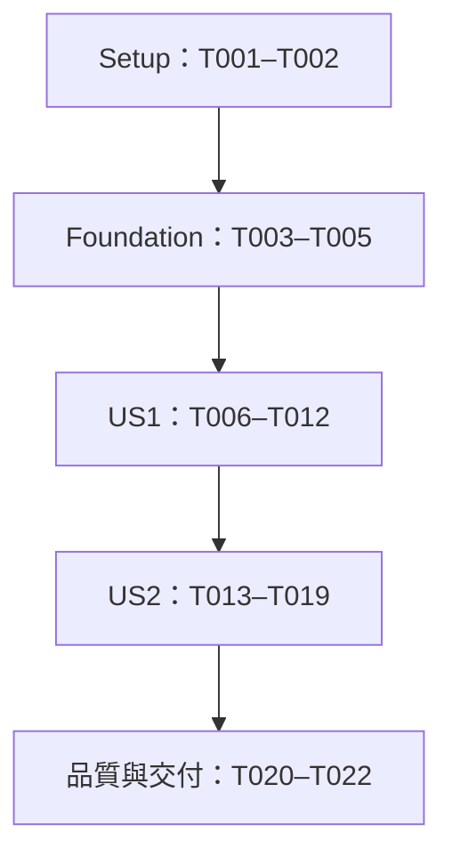

# Tasks：旅遊安排網站 — 單日行程景點清單

**範例用途**：示範小功能的任務拆解與精確閱讀指引。所有故事、契約、文件及程式路徑都是獨立的虛構情境，以假想旅遊網站根目錄為基準；來源路徑以程式碼文字呈現，只展示引用寫法，無須建立或尋找對應文件。實際生成 tasks.md 時須讀取當前專案的真實來源並核對定位；閱讀本例不代表執行清單。

**功能範圍**：在既有登入與行程日期之上，新增、查看、上下移動及移除景點，重新整理後保留結果。資料經 API 儲存於 PostgreSQL；本輪不含登入實作、多日管理、地圖、訂房或協作。

**閱讀方式**：走到任務時才載入指定區段。Must Read／必讀提供該任務的行為、介面或技術約束，執行前須掌握；Optional／按需讀取列出觸發條件，成立時即須讀取。每筆引用包含來源文件、可定位區段及用途；依任務決定等級，同一文件在不同任務可為不同等級。已讀、未變更且仍在上下文的區段可沿用；來源變更或上下文遺失時重讀。標示「前置任務產生」的紀錄執行到該任務時才查閱。

**定位方式**：Markdown 使用章節與需求／驗收編號；OpenAPI 使用 method＋path、operationId、schema／response 名稱；DBML 使用表、欄位、index／Notes。來源已有固定行號時可加行號輔助定位，但仍保留語意定位。各故事的責任與落點依 `specs/day-itinerary/plan.md`「系統範圍與責任」「目標專案結構」分組。

## 範例來源索引（虛構路徑）

以下是假想專案的來源位置，只示範索引及逐任務閱讀指引的寫法，不附上來源實體檔案。每項任務仍明列精確區段與用途；虛構路徑僅適用本範例。

| 文件 | 定位單位 |
| --- | --- |
| `specs/day-itinerary/spec.md` | US-001／US-002 的 AC、FR-001～FR-005、NFR-001／NFR-002、SC-001／SC-002 |
| `specs/day-itinerary/plan.md` | 系統範圍與責任、目標專案結構、驗證分層、交易與錯誤邊界、開發前置 |
| `specs/day-itinerary/analysis/api.openapi.yaml` | GET／POST `/days/{dayId}/items`、PATCH／DELETE `/days/{dayId}/items/{itemId}`、具名 schema／response 與共用擴充區 |
| `specs/day-itinerary/analysis/data-model.dbml` | `trips.owner_id`、`trip_days`、`day_items` 欄位／index／Notes |
| `specs/day-itinerary/analysis/ui-plan.md` | 新增與查看、排序與移除、非同步與恢復、可及性與版面 |

## Phase 1：Setup — 頁面與驗證入口

**目的**：沿用既有網站工具，建立本輪實作與測試落點。

- [ ] T001 建立 `server/features/day-items/`、`web/src/features/day-items/` 及 `web/src/pages/day-itinerary.ts` 頁面入口，沿用現有工具與鎖定版本，確認空頁面、服務及建置可啟動。

  **Must Read／必讀**：`specs/day-itinerary/plan.md`「目標專案結構」「開發前置」。用途：確認既有能力及新增檔案落點，避免將帳號系統納入本輪。

- [ ] T002 建立 `tests/fixtures/day-items.ts` 的 A／B 使用者、行程與日期，以及資料／HTTP／瀏覽器測試入口；在 `docs/development.md` 記錄測試資料庫重建、啟動、typecheck、build 與測試指令。

  **Must Read／必讀**：`specs/day-itinerary/plan.md`「驗證分層」。用途：建立真實資料庫、session 與瀏覽器的分層驗證。

  **Must Read／必讀**：`specs/day-itinerary/spec.md`「範圍」、FR-004。用途：準備既有登入與日期 fixture，以及跨擁有者拒絕案例。

**檢查點**：工具、頁面與隔離測試資料就緒，尚未宣稱景點操作可用。

## Phase 2：Foundational — 共用契約與資料骨架

**目的**：建立兩個故事共用的型別、session 邊界及資料約束。

**前置**：T001～T002 完成。

- [ ] T003 在 `shared/day-items.ts` 定義 DTO／錯誤型別，在 `server/features/day-items/routes.ts` 接上既有 session middleware 與 UUID／額外欄位拒絕；可信 caller 只來自 session。

  **Must Read／必讀**：`specs/day-itinerary/analysis/api.openapi.yaml` `x-session`、`components.parameters.DayId/ItemId`、`components.schemas.Name/AddItemInput/MoveItemInput/Item/ItemList/Error`。用途：固定識別值、輸入與回覆形狀及可信身分來源。

- [ ] T004 在 `tests/database/day-items.test.ts` 建立 schema、非負位置、同日位置唯一、同名不同 ID、擁有者 fixture 及交易 rollback 的基礎案例，確認缺少目標 schema 時案例失敗。

  **Must Read／必讀**：`specs/day-itinerary/analysis/data-model.dbml` `trips.owner_id`、`trip_days.trip_id`、`day_items` 全部欄位、`day_items_day_position_unique` 與交易 Notes。用途：建立完整資料骨架及授權關聯的測試預期。

- [ ] T005 在 `server/db/migrations/001_day_items.sql` 建立 `day_items`、FK、名稱／非負位置 checks，以及 `DEFERRABLE INITIALLY DEFERRED` 的同日位置唯一約束，通過 T004；既有 `trips`／`trip_days` 只供關聯。

  **Must Read／必讀**：`specs/day-itinerary/analysis/data-model.dbml` `day_items.name/position`、`indexes` 及延後唯一性檢查的 Notes。用途：使 schema 支援交易內交換位置而不破壞約束。

**檢查點**：共用型別、session 與 schema 基線成立；連續排序及故事行為仍待實作驗證。

## Phase 3：US-001 — 新增與查看景點（優先級：P0）

**目標**：擁有者可查看選定日期的景點，在尾端新增並於重新整理後保留。

**獨立驗證**：以 fixture 建立 A 的空白日期，新增城市公園與地方博物館，再讀取及重新整理；不需排序或移除實作。B 與無 session 均不能存取 A 的資料。

### 資料端：PostgreSQL repository

**責任與落點**：`server/features/day-items/repository.ts`；日期歸屬、清單讀取、新增與交易。

- [ ] T006 [US1] 在 `tests/database/day-items.test.ts` 建立空清單、按位置排序、尾端新增、同名不同 ID、跨擁有者拒絕、同日並行新增與中途失敗 rollback 案例。

  **Must Read／必讀**：`specs/day-itinerary/spec.md` US-001 AC1～AC3、FR-002／FR-004、NFR-002。用途：確定新增、存取與並行操作的驗收預期。

  **Must Read／必讀**：`specs/day-itinerary/analysis/data-model.dbml` `trip_days` 列鎖 Notes、`day_items.day_id/position` 與交易 Notes。用途：檢查同日序列化及無部分資料殘留。

- [ ] T007 [US1] 在 `server/features/day-items/repository.ts` 實作擁有者限定的 list／add；新增在交易內查核並鎖定日期、產生 UUID、取尾端位置、寫入與查詢完整清單，提交後才返回。

  **Must Read／必讀**：`specs/day-itinerary/plan.md`「交易與錯誤邊界」的日期歸屬、列鎖與交易內清單查詢。用途：落實可信 caller 至資料操作的共用邊界。

  **Must Read／必讀**：`specs/day-itinerary/analysis/data-model.dbml` `trips.owner_id`、`day_items.id/day_id/position` 及新增 Notes。用途：使用正確歸屬、ID 與排序欄位。

### 服務端：HTTP API

**責任與落點**：`server/features/day-items/routes.ts`；GET／POST 及契約驗證。

- [ ] T008 [P] [US1] 在 `tests/contract/day-items.test.ts` 建立 list／add 的成功、錯誤輸入、未登入、跨擁有者及內部失敗案例，驗證 status、body、無資料變更與敏感診斷資訊遮蔽。

  **Must Read／必讀**：`specs/day-itinerary/analysis/api.openapi.yaml` `GET /days/{dayId}/items`（`listDayItems`）、`POST /days/{dayId}/items`（`addDayItem`）的 requestBody／responses，以及 `components.schemas.AddItemInput/ItemList`、`components.responses.InvalidInput/Unauthenticated/NotFound/InternalError`。用途：建立 200／201／400／401／404／500 的精確 HTTP 斷言。

  **Must Read／必讀**：`specs/day-itinerary/analysis/api.openapi.yaml` `x-session`、`x-transaction.failure`。用途：核對 ownerId 注入拒絕與錯誤內容邊界。

- [ ] T009 [US1] 在 `server/features/day-items/routes.ts` 接上 T007 的 list／add，驗證正規化名稱及額外欄位，精確映射 200／201 與錯誤碼，通過 T008。

  **Must Read／必讀**：`specs/day-itinerary/analysis/api.openapi.yaml` `paths["/days/{dayId}/items"].get/post`、該 path 的 `parameters`、`components.schemas.Name/AddItemInput/ItemList`。用途：落實指定端點的參數、輸入與完整清單回覆。

### 前端：Web 頁面

**責任與落點**：`web/src/features/day-items/` 與頁面接線；欄位、清單與 HTTP 狀態。

- [ ] T010 [P] [US1] 在 `web/src/features/day-items/api.ts`、`view.ts`、`styles.css` 建立 GET／POST client、輸入正規化、清單、空狀態、錯誤與成功提示，提供事件回呼供接線。

  **Must Read／必讀**：`specs/day-itinerary/analysis/api.openapi.yaml` `listDayItems`／`addDayItem` 的 requestBody／responses、`components.schemas.Name/ItemList`。用途：使 client 與回覆清單格式一致。

  **Must Read／必讀**：`specs/day-itinerary/analysis/ui-plan.md`「新增與查看」「可及性與版面」。用途：實作欄位、名稱純文字、空狀態、焦點及窄畫面配置。

- [ ] T011 [US1] 在 `web/src/pages/day-itinerary.ts` 接上目前日期、載入及新增；成功套用完整清單，拒絕保留內容，逾時／斷線停止新變更並提供重新讀取及核對，禁止自動重送。

  **Must Read／必讀**：`specs/day-itinerary/analysis/api.openapi.yaml` `x-recovery.network/read`、`components.responses` 的 400／401／404／500。用途：區分明確失敗與結果尚未確認。

  **Must Read／必讀**：`specs/day-itinerary/analysis/ui-plan.md`「非同步與恢復」的載入中、變更中、明確錯誤、逾時及重新讀取分支。用途：對應可用操作與回饋。

- [ ] T012 [US1] 在 `tests/e2e/day-items.spec.ts` 驗證空狀態、兩筆新增、同名、無效名稱、重新整理、讀取失敗及遺失變更回覆；執行 T006／T008，於 `docs/validation/day-items.md` 記錄證據。

  **Must Read／必讀**：`specs/day-itinerary/spec.md` US-001 AC1～AC3、FR-001／FR-002／FR-004／FR-005。用途：核對獨立增量與錯誤恢復。

  **Must Read／必讀**：`specs/day-itinerary/analysis/api.openapi.yaml` `x-recovery`。用途：確認回覆遺失時不自動建立第二筆景點。

  **Optional／按需讀取**：`specs/day-itinerary/analysis/ui-plan.md`「新增與查看」「可及性與版面」。觸發條件：需加入畫面配置比對，或瀏覽器測試發現焦點／版面回歸時；用途：取得視覺及互動預期。同一文件在 T010 為必讀，本任務按上述條件讀取。

**檢查點**：US-001 可獨立展示；正式 API、資料與頁面都有驗證證據。

## Phase 4：US-002 — 排序與移除景點（優先級：P1）

**目標**：上下移動相鄰景點、移除指定項目，保存後重新整理結果一致。

**獨立驗證**：用 fixture 寫入城市公園、地方博物館、河岸步道三筆，直接驗證移動、移除及邊界；不需先經新增表單建立。正式接線依賴 US-001 的共用 repository、routes 與頁面。

### 資料端：排序交易

- [ ] T013 [US2] 擴充 `tests/database/day-items.test.ts`，建立相鄰交換、首末邊界、移除後連續位置、同名只刪指定 ID、跨日期 item 拒絕、兩筆同日變更序列化及 rollback 案例。

  **Must Read／必讀**：`specs/day-itinerary/spec.md` US-002 AC1～AC3、FR-003／FR-004、NFR-002。用途：固定排序、移除及交易驗收。

  **Must Read／必讀**：`specs/day-itinerary/analysis/data-model.dbml` `day_items.id/day_id/position`、`day_items_day_position_unique` 與交換／移除／鎖定 Notes。用途：驗證指定項目、延後唯一性與位置連續性。

- [ ] T014 [US2] 在 `server/features/day-items/repository.ts` 實作 move／remove，沿用日期歸屬與列鎖；同時以 dayId／itemId 查找，邊界不變更，成功在交易內交換或壓縮位置並取得完整清單，通過 T013。

  **Must Read／必讀**：`specs/day-itinerary/analysis/data-model.dbml` `day_items` 的相鄰交換、移除後續位置減一及同一交易 Notes。用途：落實位置維護及失敗無殘留。

  **Optional／按需讀取**：`specs/day-itinerary/plan.md`「交易與錯誤邊界」的日期列鎖與歸屬查核。觸發條件：T007 的共用交易入口需要調整，或並行測試失敗時；用途：重新核對既有鎖定責任。

### 服務端：HTTP API

- [ ] T015 [P] [US2] 在 `tests/contract/day-items.test.ts` 建立 move／remove 的成功、無效 direction、額外欄位、未登入、跨擁有者、跨日期 item、邊界與 rollback 案例。

  **Must Read／必讀**：`specs/day-itinerary/analysis/api.openapi.yaml` `PATCH /days/{dayId}/items/{itemId}`（`moveDayItem`）、`DELETE /days/{dayId}/items/{itemId}`（`removeDayItem`）的 requestBody／responses、`components.parameters.DayId/ItemId`、`components.schemas.MoveItemInput/ItemList`。用途：核對兩端點的輸入及成功回覆。

  **Must Read／必讀**：`specs/day-itinerary/analysis/api.openapi.yaml` `components.responses.InvalidInput/Unauthenticated/NotFound/Boundary/InternalError`、`x-session.ownership`。用途：建立 400／401／404／409／500 與跨日期拒絕的斷言。

- [ ] T016 [US2] 在 `server/features/day-items/routes.ts` 接上 T014，實作 PATCH direction 與 DELETE；使用契約指定 status／error code，兩者成功皆回 200 完整清單，通過 T015。

  **Must Read／必讀**：`specs/day-itinerary/analysis/api.openapi.yaml` `paths["/days/{dayId}/items/{itemId}"].patch/delete`、該 path 的 `parameters`、`components.schemas.MoveItemInput`、`components.responses.Boundary`。用途：精確處理相鄰移動、指定刪除與邊界拒絕。

### 前端：排序與移除控制

- [ ] T017 [P] [US2] 在 `web/src/features/day-items/view.ts` 增加上移、下移與移除，首末控制依條件停用，提供含名稱及序號的可及名稱，移動或移除後維持合理焦點。

  **Must Read／必讀**：`specs/day-itinerary/analysis/ui-plan.md`「排序與移除」。用途：落實控制項、同名辨識、邊界與焦點移動。

- [ ] T018 [US2] 擴充 `web/src/features/day-items/api.ts` 與 `web/src/pages/day-itinerary.ts`，接上 PATCH／DELETE，成功套用完整清單及重算序號；沿用單筆變更與恢復狀態，409 提供重新讀取。

  **Must Read／必讀**：`specs/day-itinerary/analysis/api.openapi.yaml` `moveDayItem`／`removeDayItem` 的 requestBody／responses、`components.schemas.ItemList`、`x-recovery`。用途：正確送出操作，維持結果未確認時不重送。

  **Must Read／必讀**：`specs/day-itinerary/analysis/ui-plan.md`「非同步與恢復」的 409、變更中與重新讀取分支。用途：沿用共用狀態並呈現排序衝突。

- [ ] T019 [US2] 擴充 `tests/e2e/day-items.spec.ts` 驗證三筆算例、首末停用、同名項目、移除至空清單、跨日期拒絕及重新整理；執行 T013／T015 與 US-001 回歸，更新 `docs/validation/day-items.md`。

  **Must Read／必讀**：`specs/day-itinerary/spec.md` US-002 AC1～AC3、FR-003～FR-005、SC-001／SC-002。用途：核對指定項目、持久化與存取邊界。

  **Optional／按需讀取**：`specs/day-itinerary/analysis/data-model.dbml` `day_items.day_id/position` 與排序 Notes。觸發條件：API 回覆順序與資料庫結果不一致，或發現跨日期變更時；用途：追查歸屬與位置來源。

**檢查點**：兩個故事皆可操作，完整景點清單功能有資料、API 與瀏覽器證據。

## Phase 5：Polish — 品質與交付

- [ ] T020 在 `tests/e2e/day-items.spec.ts` 補齊鍵盤、焦點、讀屏、長名稱純文字與 375px／桌面版面檢查，修正 `view.ts`／`styles.css`，結果記錄於 `docs/validation/day-items.md`。

  **Must Read／必讀**：`specs/day-itinerary/spec.md` NFR-001，以及 `specs/day-itinerary/analysis/ui-plan.md`「可及性與版面」「排序與移除」的焦點規則。用途：核對可及性、版面及操作後焦點。

- [ ] T021 執行 typecheck、build、資料／契約／瀏覽器測試，從乾淨資料庫重建 fixture，於 `docs/validation/day-items.md` 填寫 US／FR／NFR／SC 對照與實測結果，確認未知結果不自動重送及跨 caller 隔離。

  **Must Read／必讀**：`specs/day-itinerary/spec.md`「功能需求」「非功能需求」「成功標準」，以及 `specs/day-itinerary/plan.md`「驗證分層」。用途：建立跨故事通過門檻，不以單一層測試代替整體驗收。

  **Must Read／必讀**：`specs/day-itinerary/analysis/api.openapi.yaml` `x-session`、`x-transaction`、`x-recovery`。用途：核對授權、原子性與丟失回覆的跨端邊界。

- [ ] T022 核對 `docs/development.md` 與 `docs/validation/day-items.md` 的重現指令、結果與未通過項目；僅依實測證據標示完成，記錄仍需既有登入及日期資料的前置。本任務不執行部署。

  **Must Read／必讀**：`docs/development.md` 的啟動／測試指令（T002 產生），以及 `docs/validation/day-items.md` 的 US-001、US-002 與整體驗收紀錄（T012／T019～T021 產生）。用途：依前置任務的實際產出核對交付狀態。

  **Must Read／必讀**：`specs/day-itinerary/plan.md`「開發前置」，以及 `specs/day-itinerary/spec.md` SC-001／SC-002。用途：說明可重現條件並判定成功標準。

## 相依關係與執行順序



- **基礎**：T001 → T002 → T003 → T004 → T005。
- **US1**：T006 → T007；T008、T010 可在 Foundation 後與資料端平行，各自修改不同檔案。T009 等待 T007／T008，T011 等待 T009／T010，最後 T012 整合驗收。
- **US2**：T013 → T014；T015、T017 可在 US1 完成後與資料端平行。T016 等待 T014／T015，T018 等待 T016／T017，最後 T019 整合驗收。
- **品質**：T020 修正及回歸完成後執行 T021，再由 T022 核對紀錄。
- `[P]` 表示滿足前置後可與同批次獨立檔案工作平行；共用 repository、routes、view、頁面與驗收紀錄按上述順序修改。

## 平行執行範例

```text
Foundation 完成後：
  T006 資料測試、T008 GET／POST 契約測試、T010 前端呈現可平行。
  T007 資料操作與 T008 完成 → T009 API → T011 接線 → T012 驗收。

US1 驗收完成後：
  T013 排序資料測試、T015 PATCH／DELETE 契約測試、T017 前端控制可平行。
  T014 資料操作與 T015 完成 → T016 API → T018 接線 → T019 驗收。
```

## 實作策略

1. 建立共用契約、可信 caller 與資料約束。
2. 交付 US-001，先證明新增、查看及存取隔離。
3. 加入 US-002，完成相鄰排序與指定項目移除。
4. 依資料、API、瀏覽器與可及性證據完成交付紀錄。

## 任務統計與完成判準

| 階段 | 任務 | 數量 |
| --- | --- | ---: |
| Setup | T001～T002 | 2 |
| Foundation | T003～T005 | 3 |
| US1／US-001 | T006～T012 | 7 |
| US2／US-002 | T013～T019 | 7 |
| 品質與交付 | T020～T022 | 3 |
| **合計** | **T001～T022** | **22** |

- 每項 task 依自身閱讀指引取用來源；引用可定位到實際區段，不能只寫「參考 API／規格」。
- 完成時保存變更與可重現驗證；來源缺失、測試失敗或尚未執行時保持未勾選。
- 所有 checkbox 維持未完成；文件路徑及其定位為虛構示例，不能視為實際來源已查核、程式已建立或產品已驗收。
